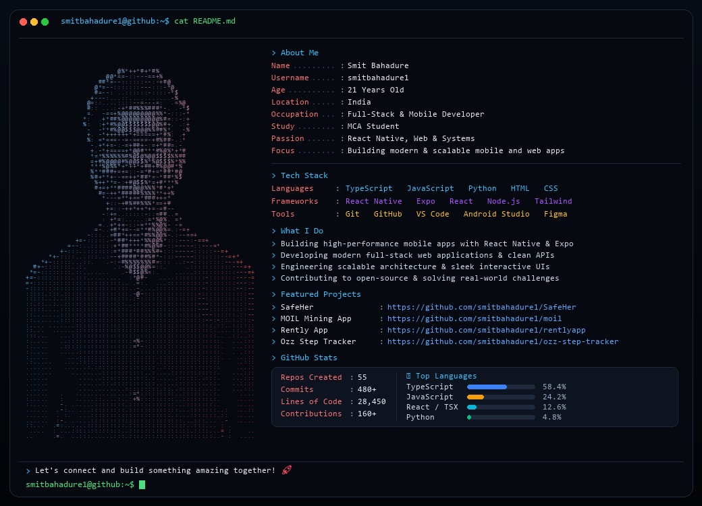

<div align="center">
  
</div>

<p align="center">
  <a href="https://github.com/smitbahadure1"></a>
  <a href="https://www.linkedin.com/in/smitbahadure"></a>
  <a href="mailto:smitbahadure@gmail.com"></a>
</p>

---

### 🚀 Featured Projects
- 🛡️ **[SafeHer](https://github.com/smitbahadure1/SafeHer)** - Women's safety mobile application with emergency response & real-time tracking built with React Native & TypeScript.
- ⛏️ **[MOIL Mining App](https://github.com/smitbahadure1/moil)** - Mining analytics & production monitoring dashboard.
- 🏠 **[Rently App](https://github.com/smitbahadure1/rentlyapp)** - Property & house rental platform.
- 👟 **[Ozz Step Tracker](https://github.com/smitbahadure1/ozz-step-tracker)** - Step tracking & health monitoring application.

---

### 💻 Tech Stack
```bash
Languages    : TypeScript • JavaScript • Python • HTML • CSS
Frameworks   : React Native • Expo • React • Node.js • Tailwind CSS
Tools        : Git • GitHub • VS Code • Android Studio • Figma
```

<div align="center">
  <sub>⚡ Powered by Cyber Terminal Profile Studio • Crafted with passion & code</sub>
</div>
